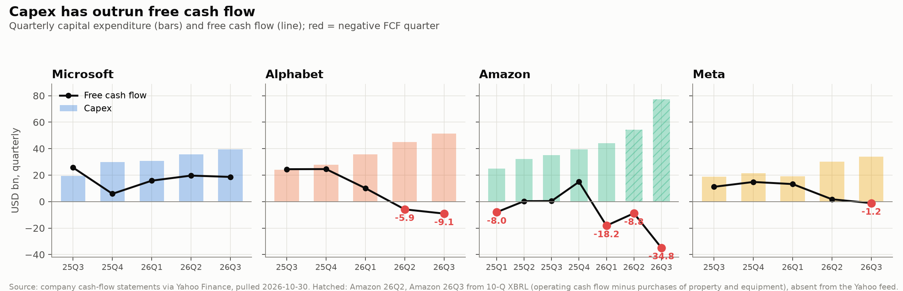
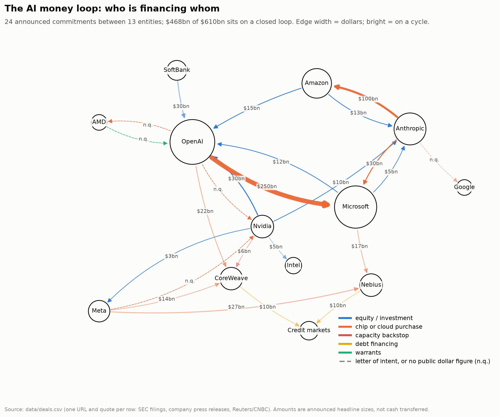
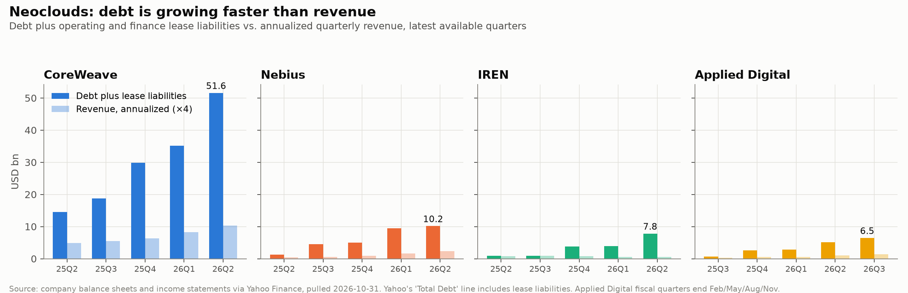
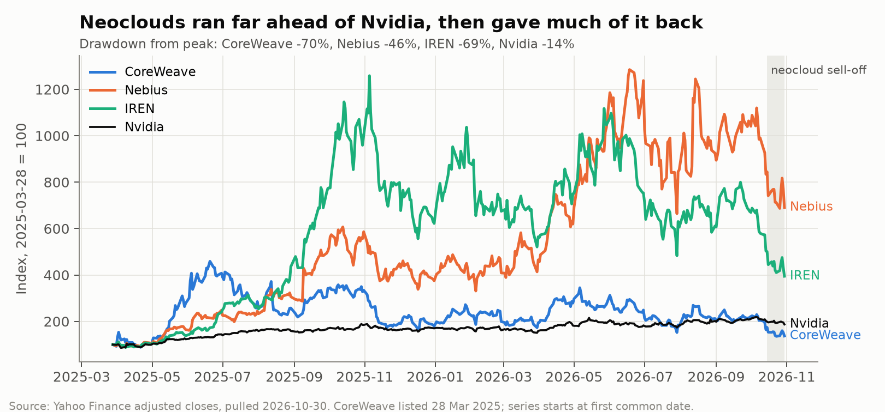
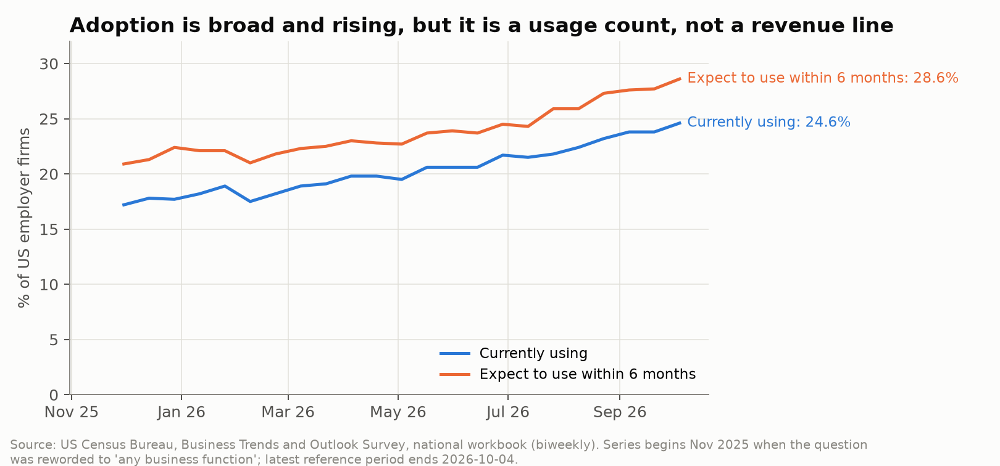

# The AI money loop

Who is paying for the AI buildout, and does the money come back?

A data-driven discussion post for QFE 5335 (Financial Analytics, Texas State University, Fall 2026). Everything in `figures/` is produced by `ai_money_loop.ipynb` from data pulled in the notebook, with the source and pull date printed on each figure.

## Four pieces of evidence

| # | Claim | Data | Figure |
|---|---|---|---|
| 1 | Hyperscaler capex has outrun free cash flow. Meta, Alphabet and Amazon each printed a negative FCF quarter in 2026. | Quarterly cash-flow statements (Yahoo Finance via `yfinance`), cross-checked against 8-Ks | `fig1_capex_vs_fcf.png` |
| 2 | Most announced AI commitments sit on a closed loop. The largest loops run through the hyperscalers and the labs, not Nvidia. | `data/deals.csv`: one row per commitment, each with a source URL and a quote from that page | `fig2_money_loop.png` |
| 3 | Neoclouds carry the debt. CoreWeave's debt plus lease liabilities went from $14.6bn to $51.6bn in four quarters; borrowings alone were $35.1bn at June 2026, and operating income was negative in the last three of those quarters. | Quarterly balance sheets and income statements for CRWV, NBIS, IREN, APLD | `fig3_neocloud_debt.png`, `fig3b_neocloud_prices.png` |
| 4 | Adoption is broad and rising, but it is a usage count, not a revenue line. | US Census Bureau, Business Trends and Outlook Survey, national workbook | `fig4_btos_adoption.png` |
| 5 | The capex is not yet earning at the pace of the spend. New cloud or ad segment revenue per dollar of capex, trailing four quarters, runs from 0.18 (Amazon) to 0.49 (Meta). | `data/segment_revenue.csv`: segment revenue and operating income from each company's 8-K earnings exhibit, one URL and quote per row | `docs/index.html` |

## Figures











## Dashboard

`docs/index.html` follows the announced money from the party that pays, to the party that receives, to its fate: round trip (on a closed loop), carried as neocloud debt, or one-way. It adds the capex-versus-segment-revenue test, the neocloud debt table, the adoption series, and a break-even calculator: required new annual revenue = capex run-rate × (1 / useful life + required return) ÷ operating margin, set against the new segment revenue visible today. The page is one self-contained file with no external scripts, built by `build_dashboard.py` from the same CSVs the notebook writes, so it can be served from GitHub Pages.

## Run it

```bash
pip install -r requirements.txt
jupyter nbconvert --to notebook --execute --inplace ai_money_loop.ipynb
```

Or run the scripts in order: `pull_data.py`, `pull_sec.py`, `figures.py`, `money_loop.py`, `btos.py`. `pull_sec.py` fills quarters the Yahoo feed lacks from SEC XBRL and needs `SEC_CONTACT` set to a name and email (the SEC requires one in the User-Agent); without it the script leaves the Yahoo rows unchanged. `build_notebook.py` regenerates the notebook from the scripts, and `build_dashboard.py` regenerates `docs/index.html`.

`explore.ipynb` is a scratch notebook that loads every dataset into a DataFrame and gives helpers to re-cut them: what-ifs on the loop (drop an edge, count conditional rows), capex and segment tables and plots for any tickers, indexed price paths, a break-even sweep, and guarded functions to append a sourced row to `deals.csv` or `segment_revenue.csv`. `build_explore.py` regenerates it; nothing in the figures or the write-up depends on it. On Windows, set `PYTHONUTF8=1` first; `money_loop.py` prints arrows the default console codepage cannot encode.

The Census workbook is fetched from `https://www.census.gov/hfp/btos/downloads/National.xlsx`. A copy is kept in `raw/` in case the download path changes.

## How the deal table works

`data/deals.csv` columns: `from, to, type, amount_usd_bn, date, status, source_url, quote, note`.

- `status` is one of `LOI`, `committed`, `funded`, `conditional`, `unverified`. Only the first three enter the graph.
- `unverified` means the figure rests on anonymous-sourced press reports only. The OpenAI→Oracle $300bn and Oracle→Nvidia $40bn legs are both in this bucket.
- `conditional` means announced by a party but contingent on future conditions. The $35bn second tranche of Amazon's $50bn OpenAI investment is the one row; the $15bn first tranche enters the graph as `committed`.
- Amounts marked "up to" in the `note` column are contract ceilings, not firm spend.
- Commitments with no public dollar figure (OpenAI's 10 GW Nvidia and 6 GW AMD purchases) are drawn dashed with zero weight, so the closed-loop share is a lower bound.
- Four editorial exclusions are stated in `money_loop.py`: the superseded $100bn Nvidia→OpenAI LOI, the $500bn third-party financing-platform MOU (six firms, no Nvidia outlay), the non-binding cornerstone indication in Meta's October 2026 prospectus, and the SK Group and Nvidia $500bn-plus partnership LOI (two-way, no disclosed split).

Cycle dollars are the sum of edge amounts that sit on at least one simple cycle (`networkx.simple_cycles`). `figures/table_cycles.csv` lists every cycle.

## Limitations

- Yahoo's statement labels are not GAAP line items. Meta's Q3 2026 capex is $33.9bn on Yahoo and $34.9bn in the 8-K, and Microsoft's is $39.4bn on Yahoo and $45.2bn as Microsoft reports it; both differences are finance leases. Check any number you quote against the filing linked in `deals.csv`.
- Yahoo's "Total Debt" line includes operating and finance lease liabilities. For CoreWeave at June 30, 2026 the 10-Q shows $35.1bn of recourse and non-recourse debt, $0.2bn of finance leases and $16.3bn of operating leases, which sum to Yahoo's $51.6bn. Figure 3 and `table_neocloud_coverage.csv` use the Yahoo figure and label it debt plus lease liabilities.
- Yahoo's quarterly feed runs about five quarters deep and was missing Amazon's Q2 and Q3 2026 at the time of the pull, three months after the Q2 10-Q was filed. Those two quarters come from the 10-Q XBRL tags Yahoo itself reads (`NetCashProvidedByUsedInOperatingActivities`, `PaymentsToAcquireProductiveAssets`); Amazon's Q1 2026 matches Yahoo to the million on both, so the definition is unchanged. They are marked `source=sec` in `data/hyperscaler_cashflow.csv` and hatched in figure 1.
- The Census AI-use series starts November 2025, when the question was reworded to "any business function". Earlier readings are not comparable.
- Deal amounts are announced headline sizes, not cash transferred.

## Data sources

- Company cash-flow statements, balance sheets, income statements and prices: Yahoo Finance via `yfinance`; quarters absent from the feed filled from SEC XBRL (`data.sec.gov` company-concept API)
- Deal table: SEC filings (8-K, 10-Q, 6-K, S-1, FWP), company press releases, Reuters, CNBC, Bloomberg; each row carries its own URL
- Segment revenue and operating income (`data/segment_revenue.csv`): each company's quarterly earnings release as filed on Form 8-K, Exhibit 99.1, hand-entered with the table row or sentence quoted. 2024 quarters come from the prior-year column of the 2025 releases. Microsoft retired its Intelligent Cloud segment in the quarter ended September 30, 2026, so its series stops at June 2026; the same release printed Azure revenue in dollars for the first time, recorded separately.
- US Census Bureau, Business Trends and Outlook Survey (biweekly, national)
